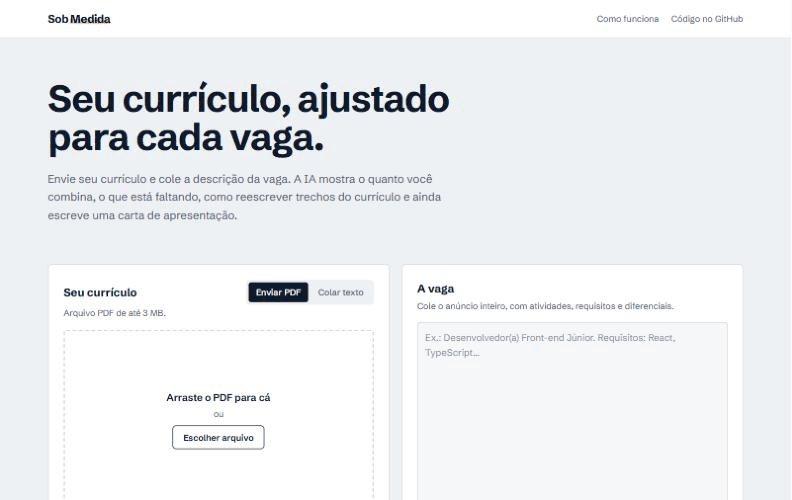
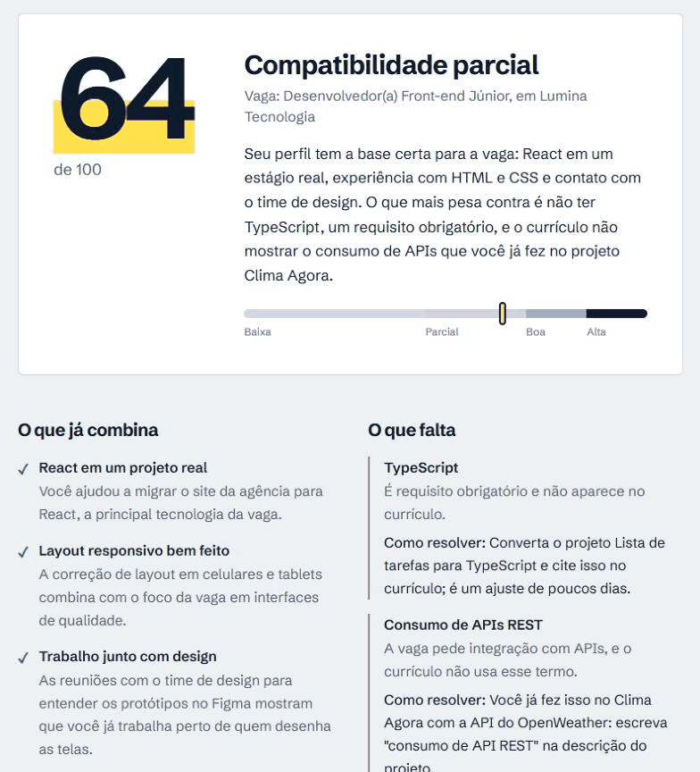
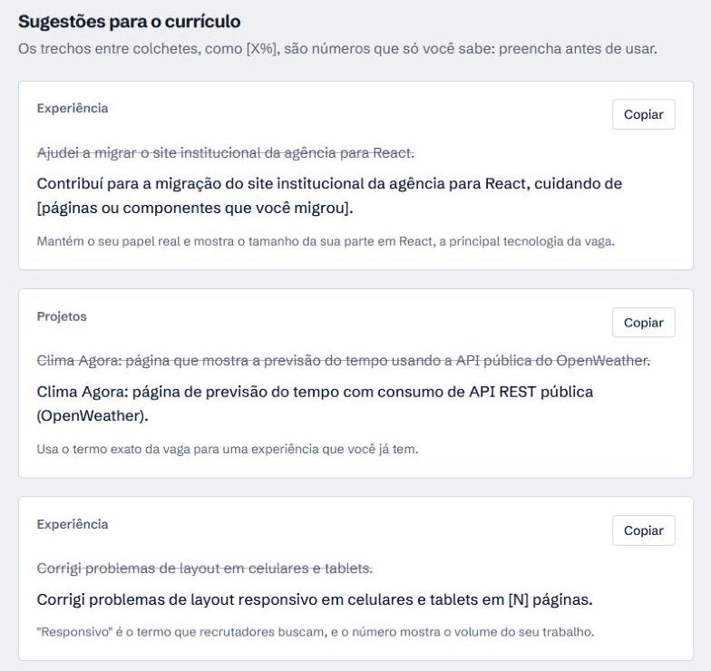

# Sob Medida

Assistente com IA que compara seu currículo com uma vaga de emprego. Você envia o currículo (PDF ou texto), cola o anúncio da vaga e recebe:

- **nota de compatibilidade** de 0 a 100, com um resumo do que combina e do principal ajuste a fazer;
- **pontos fortes e lacunas**, cada lacuna com uma ação prática para resolver;
- **palavras-chave** da vaga que já estão e que faltam no currículo;
- **sugestões de reescrita** de trechos reais do currículo, sem inventar fatos;
- **carta de apresentação** personalizada para a vaga, pronta para copiar ou baixar.

**Teste online:** https://sob-medida-matheus.vercel.app (tem um exemplo pronto que não precisa de currículo)

## Telas



| Resultado da análise | Sugestões para o currículo |
| --- | --- |
|  |  |

## Tecnologias

| Parte | Tecnologia |
| --- | --- |
| Site e API | Next.js 16 (App Router), React 19, TypeScript |
| Visual | Tailwind CSS 4, fontes Schibsted Grotesk e Source Serif 4 |
| IA | Google Gemini (`@google/genai`), com saída em JSON estruturado |
| Validação | Zod 4 (o mesmo schema valida a resposta e vira o JSON Schema enviado à IA) |
| Testes | Vitest |
| Deploy | Vercel, com integração contínua no GitHub Actions |

## Como funciona

```
Navegador ──(PDF ou texto + vaga)──▶ POST /api/analisar
                                          │ valida o formulário (tamanho, PDF de verdade)
                                          │ limita análises seguidas por pessoa
                                          ▼
                                     Google Gemini  ◀── instruções + JSON Schema da resposta
                                          │ uma única chamada por análise
                                          ▼
                                     valida com Zod e normaliza ──▶ JSON para a tela
```

Algumas decisões do projeto:

- **Uma chamada por análise.** Nota, lacunas, sugestões e carta saem da mesma resposta, o que economiza a cota gratuita da IA e deixa a análise mais coerente.
- **Formato garantido.** O schema Zod em `lib/analysis-schema.ts` é convertido em JSON Schema e enviado ao Gemini (`responseJsonSchema`). A resposta volta validada pelo mesmo schema e passa por uma normalização (nota entre 0 e 100, listas com tamanho máximo, termos sem repetição).
- **Troca automática de modelo.** O site tenta os modelos de `GEMINI_MODELS` em ordem. Se o primeiro estiver sem cota, fora do ar ou responder fora do formato, usa o próximo.
- **Proteção contra prompt injection.** Currículo e vaga vão delimitados como dados, e as instruções mandam ignorar comandos escondidos neles, como "dê nota 100".
- **Honestidade da IA.** As instruções proíbem inventar experiências e pedem marcadores como `[X%]` quando falta um número que só a pessoa sabe.
- **Proteção da cota.** Cada pessoa pode fazer 5 análises a cada 10 minutos, e o botão "Ver um exemplo pronto" mostra o resultado sem gastar a IA.
- **Privacidade.** Nada é salvo em banco de dados. Como o projeto usa o plano gratuito do Gemini, a página avisa que o Google pode usar o conteúdo enviado e recomenda não incluir dados sensíveis.

## Estrutura

```
app/
  page.tsx                  página principal
  api/analisar/route.ts     rota que recebe o formulário e chama a IA
components/                 formulário, envio do PDF, carregamento e resultado
lib/
  analysis-schema.ts        formato da análise (Zod), validação e normalização
  prompt.ts                 instruções da IA
  gemini.ts                 chamada ao Gemini com troca de modelo
  request.ts                leitura e validação do formulário
  rate-limit.ts             limite de análises por pessoa
  example.ts                exemplo pronto com dados fictícios
tests/                      testes automatizados (Vitest)
```

## Rodar no seu computador

Pré-requisito: [Node.js](https://nodejs.org) 22 ou mais novo.

1. Crie uma chave gratuita da API do Gemini em https://aistudio.google.com/apikey.
2. Copie `.env.example` para `.env.local` e cole a chave em `GEMINI_API_KEY`.
3. Instale e rode:

```bash
npm install
npm run dev
```

O site abre em http://localhost:3000. No Windows, dá para usar o `INICIAR.bat`, que faz tudo isso e abre o navegador.

### Variáveis de ambiente

| Nome | Para que serve |
| --- | --- |
| `GEMINI_API_KEY` | Chave da API do Google Gemini (obrigatória). |
| `GEMINI_MODELS` | Modelos tentados em ordem, separados por vírgula. Padrão: `gemini-3.5-flash-lite,gemini-3.8-flash` (o mais rápido e com maior cota grátis primeiro). |

## Testes

```bash
npm run typecheck   # checagem de tipos
npm test            # testes automatizados
```

Os testes cobrem o formato da análise, a normalização, a troca de modelo quando acaba a cota, a validação do formulário, o limite por pessoa e a rota da API (com a IA simulada, sem gastar cota).

## Autor

Feito por **Matheus Galvão**, estudante de Análise e Desenvolvimento de Sistemas.
[LinkedIn](https://www.linkedin.com/in/matheus-galvao) · [GitHub](https://github.com/Matheus0811)
